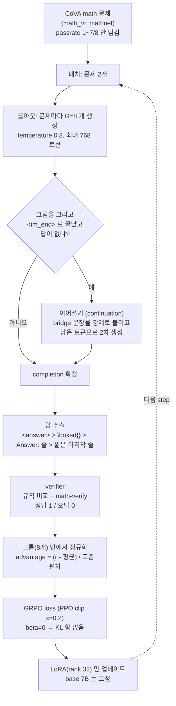
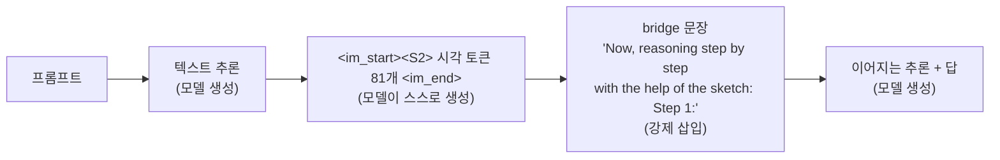
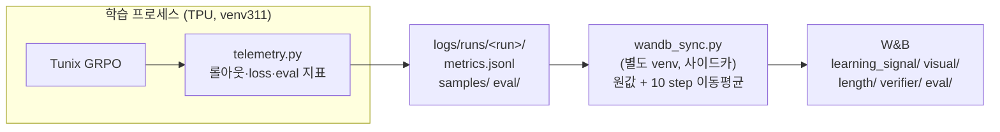

# tar-rlvr

Tar-7B(Qwen2.5-7B + 65,536 시각 토큰)에 CoVA 태스크로 RLVR(GRPO). JAX/Tunix, TPU v6e.

## 학습이 어떻게 이루어지나

### GRPO 한 step



- 보상은 **정답 여부 하나뿐**이다. 그림을 그린다고 보상을 더 주지 않는다 → 그림이 정답률을 올릴 때만 살아남는지 본다.
- 그룹 8개가 전부 맞거나 전부 틀리면 advantage 가 0 이라 그 문제에서는 배우는 게 없다. 그래서 base 모델 기준 passrate 가 1~7/8 인 문제만 쓴다.

### 그림이 들어간 completion 의 모양

Tar 는 이미지 생성 모델이라 `<im_end>` 직후 EOS 를 내는 경향이 강하다. 그대로 두면 그림을 그린 샘플은 답에 도달하지 못해 항상 0점 → 그림 그리기가 바로 억제된다. 그래서 그림 뒤에 문장을 이어 붙여 추론을 계속하게 한다 (`tar_rlvr/train/continuation.py`).



- **그림을 시작할지는 모델이 정한다.** 강제하는 건 그림이 *끝난 뒤* 의 bridge 뿐이다.
- bridge 토큰도 학습 대상이라, advantage 가 양수면 "그림 뒤에 이어서 추론하기" 확률이 올라간다.

### 지표가 W&B 까지 가는 길



학습 프로세스는 파일만 쓰므로 업로드가 실패해도 학습은 멈추지 않는다.

```bash
# 학습
python scripts/train.py --config configs/tpu_v6e_7b.yaml --run-name run5
# 업로드 (다른 셸)
/mnt/work/wandb-venv/bin/python scripts/wandb_sync.py logs/runs/run5 --entity <팀> --follow
```

## 왜 이 구조인가
- Tar는 vocab만 확장된 Qwen2.5 → Tunix qwen2 구현에 `vocab_size`만 덮어쓰면 로드됨 (`tar_rlvr/model/tar.py`).
- CoVA 문제는 텍스트 입력 → RL 중엔 TA-Tok 인코더(PyTorch) 불필요. 시각 토큰은 모델이 생성하는 latent workspace, reward는 `<answer>` 텍스트만 봄.
- Reward는 전부 순수 파이썬 verifier → **하드웨어 없이 100% 테스트** (`tests/`).
- `configs/smoke_cpu.yaml`: 랜덤 tiny 모델 + 합성 데이터로 GRPO 루프 end-to-end. CI에서 돌아감.

## 검증 순서 (돈 쓰기 전에)
1. `pip install -e ".[cpu,dev]" && pytest -q` — verifier
2. `python scripts/check_env.py` — Tunix API 심볼 존재 확인 (API 드리프트 감지)
3. `python scripts/train.py --config configs/smoke_cpu.yaml --max-steps 2` — 루프
4. `python scripts/inspect_cova.py` → `configs/tpu_v6e_7b.yaml` 의 컬럼/`TASK_MAP` 채우기
5. TPU VM: `scripts/tpu_setup.sh` → 같은 스모크 → `configs/tpu_v6e_7b.yaml`

## 구조
```
configs/          smoke_cpu.yaml, tpu_v6e_7b.yaml
tar_rlvr/model/   tar.py(로드/LoRA), tiny_tokenizer.py
tar_rlvr/data/    synthetic.py, cova.py
tar_rlvr/rewards/ parsing.py, verifiers.py(task별), __init__.py(Tunix reward_fns)
tar_rlvr/train/   grpo.py (Tunix 어댑터 — API 바뀌면 여기만), continuation.py(그림 뒤 이어쓰기),
                  telemetry.py(학습 지표), debug_log.py
scripts/          train.py, check_env.py, inspect_cova.py, tpu_setup.sh,
                  wandb_sync.py(W&B 업로드), rescore_log.py(로그 재채점), summarize_log.py, decode_visual.py
tests/            test_rewards.py
```

## TODO
- [ ] CoVA 스키마 확인 → `cova.py` TASK_MAP / ref 구성 (sudoku: puzzle, coloring: edges,k)
- [ ] Tar 토크나이저에 `<I*>` added_tokens 있는지 확인 (`load_tokenizer` assert)
- [ ] Tunix 설치 버전에 맞춰 `grpo.py` 어댑터 필드명 맞추기
- [ ] 롤아웃 엔진 vanilla → vLLM-TPU 전환 (7B 샘플링 속도)
- [ ] 평가: CoVA-Bench(1,700) 스크립트
